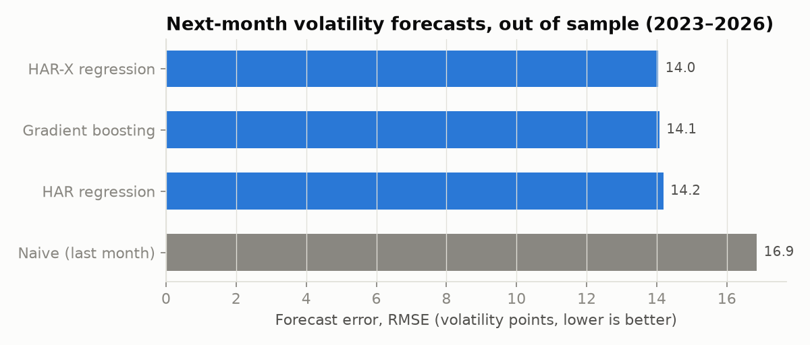
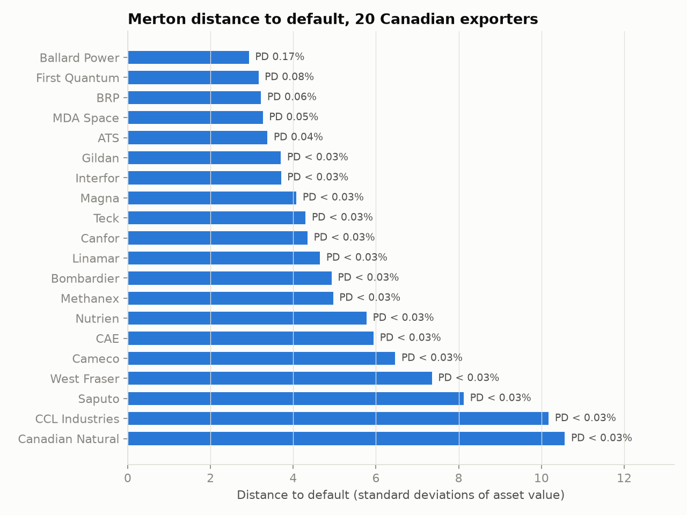
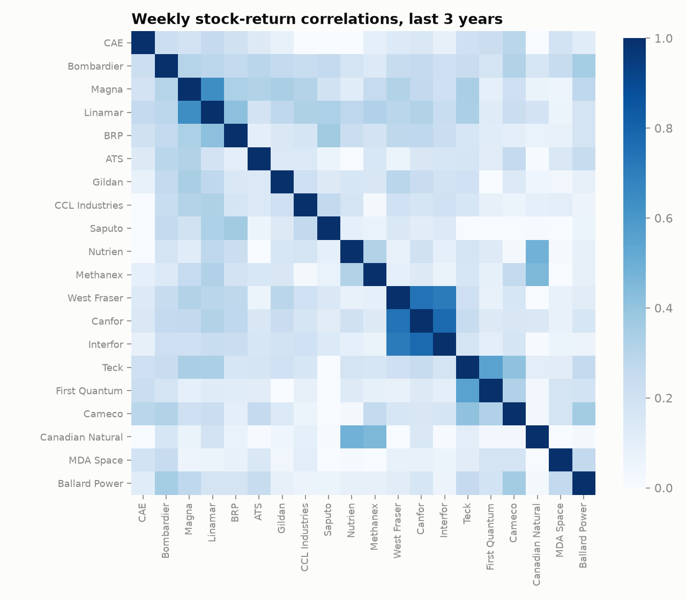
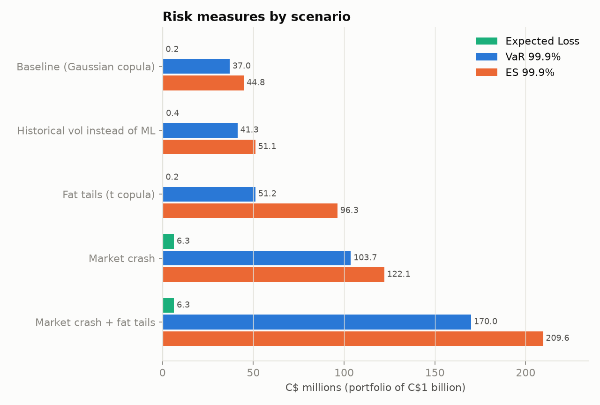
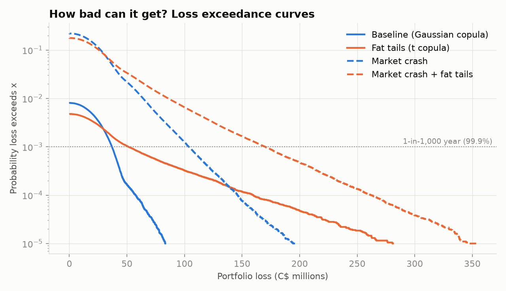

# Canadian Exporter Credit Risk Engine

How much could a lender lose if it insured C$1 billion of credit to 20 Canadian exporters?
This project answers that from live market data, in three stages:

1. **Machine learning** forecasts each firm's stock-market volatility for the next month.
2. **The Merton model** (Black-Scholes applied to a balance sheet) turns stock price, volatility
   and debt into each firm's probability of default.
3. **Monte Carlo simulation** (2 million scenarios, correlated defaults) gives the loss
   distribution: Expected Loss, Value at Risk, Expected Shortfall, and stress scenarios.

Data as of **23 October 2026**: Yahoo Finance daily prices (2015–2026) and latest balance
sheets for 20 TSX-listed exporters across aerospace, autos, lumber, mining, energy, agri-food
and clean tech.

```
pip install -r requirements.txt
python fetch_data.py     # downloads Yahoo Finance data into yahoo_data/
python run.py            # ~15 seconds; results and charts in outputs/
```

---

## 1. Machine learning: forecasting volatility

Volatility is the input the Merton model is most sensitive to, so forecasting it well matters.
Each firm-month is one observation (about 2,500 in total). Models train on 2016–2022, the
champion is chosen by time-series cross-validation **inside** that period, and the 2023–2026
data is used once, as a true out-of-sample test.

| Model | CV RMSE | Test RMSE | Test MAE |
|---|---|---|---|
| Naive (next month = last month) | 22.4 | 16.9 | 11.0 |
| HAR regression (Corsi, 2009) | 19.7 | 14.2 | 9.6 |
| **HAR-X regression** (champion) | **18.4** | **14.0** | **9.4** |
| Gradient boosting on HAR residuals | 19.0 | 14.1 | 9.6 |

*Errors in volatility points (annualised %).* The champion cuts forecast error by **17% vs. the
naive benchmark**. Gradient boosting did not beat a well-specified linear model: volatility is
highly persistent and close to linear in logs, a common finding in the forecasting literature.
Features: realised volatility over 1 week, 1 month, 1 quarter and 1 year; recent stock and TSX
returns; drawdown from the 1-year high; TSX volatility; trading volume vs. normal; market beta.



## 2. Merton model: probability of default

Shareholders hold a call option on the firm's assets, struck at its debt. Observing equity
value *E* and equity volatility σ_E, two Black-Scholes equations are solved numerically for
each firm's unobserved asset value *V* and asset volatility σ_V:

  E = V·N(d₁) − D·e^(−rT)·N(d₂)  and  σ_E·E = N(d₁)·σ_V·V

Distance to default DD = d₂ (standard deviations between assets and the default point);
PD = N(−DD). Inputs: Yahoo market capitalisation (all share classes, C$); default point =
current liabilities + ½ long-term debt (Moody's KMV convention); USD debt converted at
USD/CAD 1.4005; risk-free rate 3.01% (Government of Canada 1-year T-bill); horizon one year.
PDs are floored at 0.03%, the Basel II corporate floor.



Ballard Power (DD 2.9), First Quantum, BRP, MDA Space and ATS are the riskiest names; Canadian
Natural and CCL Industries are the safest. **The volatility forecast changes the answer:** BRP's
PD is 0.64% using trailing one-year volatility but 0.06% using the forecast, because its stock
has calmed down. Across the book, the forecast halves expected loss vs. historical volatility.

## 3. Monte Carlo: portfolio losses

Hypothetical book: C$50M insured exposure to each firm (C$1B total), loss given default
Beta-distributed with mean 45%. Defaults are correlated through a copula built from the firms'
actual weekly stock-return correlations over the last three years (average pairwise 0.17;
lumber producers above 0.7 with each other, Teck and First Quantum 0.55).



| Scenario (C$ millions) | Expected Loss | VaR 99% | VaR 99.9% | ES 99.9% |
|---|---|---|---|---|
| Baseline (Gaussian copula) | 0.19 | 0.0 | 37.0 | 44.8 |
| Historical vol instead of ML | 0.38 | 19.2 | 41.3 | 51.1 |
| Fat tails (t copula, 4 d.f.) | 0.19 | 0.0 | 51.2 | 96.3 |
| Market crash (stocks −30%, vol ×1.5) | 6.28 | 64.0 | 103.7 | 122.1 |
| Market crash + fat tails | 6.31 | 85.9 | 170.0 | 209.6 |




**What the results say**
- **A concentrated book is all tail.** With 20 investment-grade-like names, there is a 99%
  chance of losing nothing in a year, yet the 1-in-1,000-year loss is C$37M. Expected loss
  alone would badly understate the risk.
- **Tail dependence matters more than the averages.** The t copula keeps every firm's PD and
  every pairwise correlation the same, but lets extreme moves happen together. Expected loss is
  unchanged; 99.9% VaR rises 38% and Expected Shortfall more than doubles. This is the
  weakness of the Gaussian copula that was widely discussed after 2008.
- **Stress scenarios run through the structural model.** A 30% equity drop with 50% higher
  volatility is fed back through Merton, raising Ballard's PD to 7.3% and First Quantum's to
  4.6%. Expected loss rises 33×, and combined with fat tails the 99.9% VaR reaches C$170M.

## Validation

| Check | Result |
|---|---|
| Merton solver | Both equations solved to < 1e-6 relative error for every firm |
| Monte Carlo expected loss vs. closed form Σ PD·LGD·EAD | Within the 95% simulation interval in all five scenarios |
| Simulated default rate per firm vs. input PD | Max gap 0.005% baseline, 0.03% crash (sampling noise) |
| Volatility model | Selected by time-series CV; test set used once |

## Assumptions and limitations

- Merton PDs are risk-neutral (assets drift at the risk-free rate) and raw Merton PDs are known to
  understate real default rates; commercial models (Moody's EDF) map distance to default to
  historical default frequencies, which is proprietary. Results are best read as relative risk.
- Exposure, LGD and the crash scenario are illustrative assumptions, set at the top of
  `src/monte_carlo.py` and `run.py`.
- Equity correlations proxy asset correlations (standard CreditMetrics practice).
- Balance sheets are the latest annual report; Yahoo Finance data quality applies.

## Files

| File | Purpose |
|---|---|
| `fetch_data.py` | Downloads prices, volume and balance sheets from Yahoo Finance |
| `src/data.py` | Cleans data, converts currencies, sets the Merton default point |
| `src/vol_model.py` | Volatility features, models, time-series CV, forecasts |
| `src/merton.py` | Solves the Merton system per firm; PD and distance to default |
| `src/monte_carlo.py` | Gaussian and t copula simulation; VaR and Expected Shortfall |
| `run.py` | Runs everything, writes tables and charts to `outputs/` |

## References

Corsi, F. (2009). A Simple Approximate Long-Memory Model of Realized Volatility. *Journal of Financial Econometrics.*
Crosbie, P. & Bohn, J. (2003). *Modeling Default Risk.* Moody's KMV.
Duan, N. (1983). Smearing Estimate: A Nonparametric Retransformation Method. *JASA.*
Gupton, G., Finger, C. & Bhatia, M. (1997). *CreditMetrics — Technical Document.* J.P. Morgan.
Merton, R. (1974). On the Pricing of Corporate Debt. *Journal of Finance.*
Data: Yahoo Finance via `yfinance`; Bank of Canada (1-year T-bill, 21 Oct 2026); USD/CAD close 23 Oct 2026.
